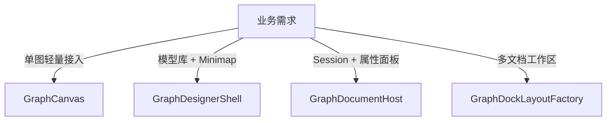
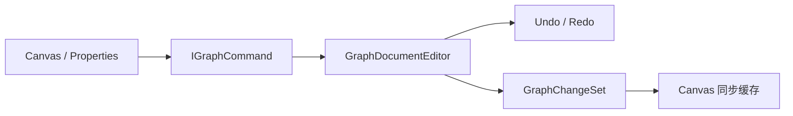
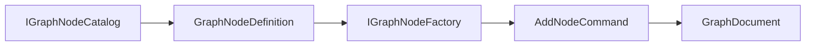
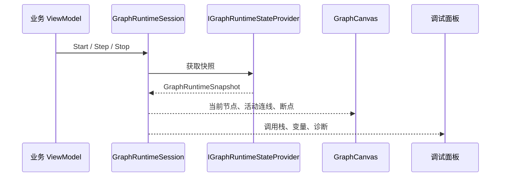
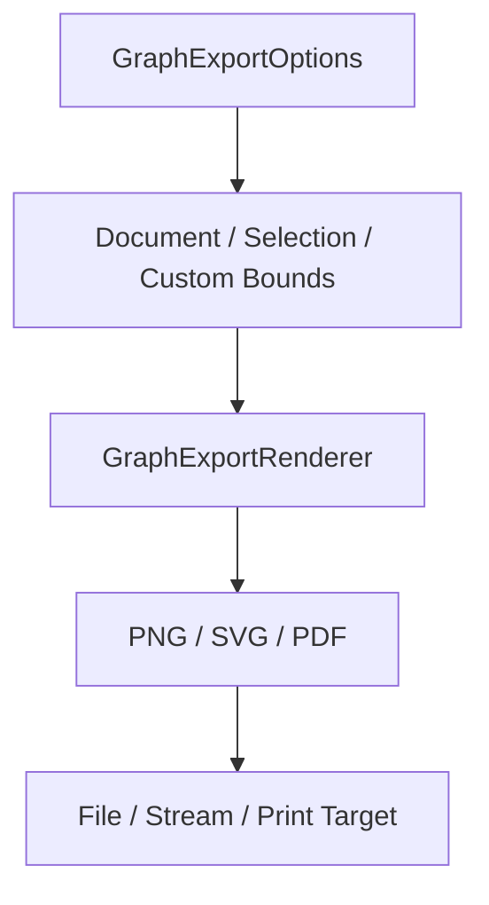
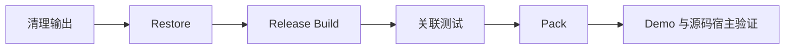

# Kudo.Avalonia 使用与开发手册

本文面向业务项目接入和二次开发，保留最常用路径。架构细节看 `架构与设计.md`，性能数据看 `性能优化.md`。

## 1. 快速接入

### 1.1 还原依赖

所有 SDK 源码均在本仓库内，第三方依赖全部来自 nuget.org；克隆仓库后直接 `dotnet restore` 即可还原，无需配置任何私有包源。

按实际使用范围添加包引用：

```xml
<PackageReference Include="Kudo.Core" />
<PackageReference Include="Kudo.Avalonia" />
<PackageReference Include="Kudo.Themes" />
```

只处理模型和 JSON 时引用 `Kudo.Core`；需要 3D 预览时再添加 `Kudo.Avalonia.3D`。

### 1.2 选择控件

| 需求 | 推荐入口 |
|---|---|
| 只显示或编辑一张图 | `GraphCanvas` |
| 需要模型库、Minimap、Viewport 绑定 | `GraphDesignerShell` |
| 需要 Session、Ruler、工具条、Undo/Redo、属性上下文 | `GraphDocumentHost` |
| 需要多文档 Dock 工作区 | `GraphDockLayoutFactory` + `GraphDocumentView` |



### 1.3 创建第一张图

```csharp
using Kudo;
using Kudo.Avalonia;

var source = new NodeModel
{
    Id = "source",
    Type = "input",
    Title = "数据源",
    Position = new GraphPoint(80, 100)
}.AddPort(new PortModel
{
    Id = "out",
    Name = "Out",
    Kind = PortKind.Output,
    Capacity = new PortCapacity { MaxOutgoing = null }
});

var target = new NodeModel
{
    Id = "target",
    Type = "output",
    Title = "结果",
    Position = new GraphPoint(380, 100)
}.AddPort(new PortModel
{
    Id = "in",
    Name = "In",
    Kind = PortKind.Input
});

var document = new GraphDocument
{
    Title = "第一张图",
    Nodes = [source, target]
};
document.AddEdge(new EdgeModel
{
    Id = "source-target",
    Source = new PortReference("source", "out"),
    Target = new PortReference("target", "in"),
    TargetMarker = EdgeMarker.Arrow,
    Label = "数据",
    StylePreset = GraphEdgeStylePreset.ActiveFlow
});

Content = new GraphCanvas { Document = document };
```

### 1.4 AXAML 接入

```xml
<k:GraphDesignerShell xmlns:k="https://codewf.com"
                      Document="{Binding Document}"
                      Catalog="{Binding NodeCatalog}"
                      NodeRequestedCommand="{Binding AddNodeCommand}"
                      IsReadOnly="{Binding IsReadOnly}"
                      Viewport="{Binding Viewport}"
                      ViewportOptions="{Binding ViewportOptions}"
                      GridSettings="{Binding GridSettings}"
                      RuntimeSnapshot="{Binding RuntimeSnapshot}"
                      BreakpointNodeIds="{Binding BreakpointNodeIds}"
                      SelectedNodeIds="{Binding SelectedNodeIds, Mode=OneWayToSource}"
                      SelectedGroupIds="{Binding SelectedGroupIds, Mode=OneWayToSource}"
                      SelectedEdgeIds="{Binding SelectedEdgeIds, Mode=OneWayToSource}"
                      SelectedNodeId="{Binding SelectedNodeId}"
                      SelectedEdgeId="{Binding SelectedEdgeId}"
                      SelectedAnnotationId="{Binding SelectedAnnotationId}"
                      SelectionChangedCommand="{Binding SelectionChangedCommand}"
                      GraphEditCommittedCommand="{Binding GraphEditCommittedCommand}"
                      GraphEditRejectedCommand="{Binding GraphEditRejectedCommand}"
                      ConnectionValidationChangedCommand="{Binding ConnectionValidationChangedCommand}" />
```

Viewport 由 `Offset + Zoom` 组成。默认缩放范围是 10% 到 500%，可通过 `ViewportOptions` 覆盖；当前 Viewport 值可以按《模型配置与任务文件格式设计》持久化到任务文件，`ViewportOptions` 仍然只是运行时策略，不写入任务文件。

## 2. 编辑、选择与历史

模型修改推荐走命令：



常用规则：

- 新增、删除、移动、改属性都应落到 `IGraphCommand`。
- 直接改模型后调用 `Synchronize`；不知道变更范围时传全量刷新。
- 多选拖动、批量删除和属性批量提交应合并为一条历史。
- 选择快照推荐用 `SelectedNodeIds`、`SelectedEdgeIds`、`SelectedGroupIds` 的 `OneWayToSource` 绑定。
- `SelectedEdgeId` 表示主 Edge；标签、端点、Waypoint 和线段编辑只作用于主 Edge。
- `Shift + 单击`切换 Edge 多选；删除、复制、路由样式和清除 Waypoint 作用于完整的 `SelectedEdgeIds`。
- `NodeModel.IsLocked` 用于保护布局：锁定节点仍可选择、查看、改标题与外观、连接端口，但不能移动、微调、缩放、旋转、删除或被布局和节点推挤移动。
- 混合选择时，移动、微调和删除只处理未锁定节点；`SetSelectedNodesLocked` 的批量锁定或解锁只写入一条 Undo 历史。
- 置顶和置底使用 `EditorContext.Edit.BringSelectedNodesToFront()`、`SendSelectedNodesToBack()`；多选节点保持文档中的相对顺序，操作进入 Undo/Redo 历史。锁定节点或只读画布会拒绝该操作。
- 右键菜单可以由宿主创建并赋给 `GraphCanvas.ContextMenu`，但菜单回调应调用 SDK 编辑入口；不要在菜单事件中直接调整 `GraphDocument.Nodes`。结构变更期间，SDK 会自动取消未完成的手动连线草稿。

端口显示有两层开关：`GraphCanvasSettings.ShowPorts`（或 `GraphCanvas.ShowPorts`）控制整张画布，`PortModel.IsVisible` 控制单个端口。隐藏端口不渲染、不能命中或发起交互连线，但已有 Edge 仍使用它计算路由端点。

## 3. 模型库与拖放

最小扩展链路：



约定：

- `GraphNodeDefinition` 只描述类型、名称、默认尺寸、图标和模板信息。
- `IGraphNodeFactory` 负责创建真实 `NodeModel`。
- 拖入画布时使用 `ScreenToGraph` 得到图坐标。
- 模型资源和任务资源分离；任务保存时只保留实际使用资源的相对路径。

## 4. 属性面板

`GraphPropertiesView` 通过 `EditorContext` 显示当前上下文：

| 选择状态 | 属性上下文 |
|---|---|
| 未选中 | Document |
| 单节点 | Node |
| 多节点 | Node 多选摘要 |
| 完整单 Group | Group |
| Edge | Edge |
| Annotation | Annotation |

自定义属性页实现 `IGraphPropertyEditorProvider`。属性修改应生成命令，接受只读状态和宿主编辑策略检查。

## 5. Runtime 调试



Runtime 只投影视觉状态，不修改 `GraphDocument`。断点集合通过 `BreakpointNodeIds` 同步到画布。

## 7. 连线样式与动画

优先使用预设：

```csharp
edge.StylePreset = GraphEdgeStylePreset.ActiveFlow;
```

常用预设包括默认、成功、警告、错误、活动流、调试命中、弱化和高亮。自定义样式使用 `GraphEdgeAppearance`，可设置颜色、线宽、Dash、Glow、动画速度和方向。

渲染规则：

- 样式变化会触发画布刷新。
- 动画由画布共享 Timer 驱动，不为每条 Edge 创建 Timer。
- Runtime 活动 Edge 与静态样式合成显示。

## 8. 导出与打印



示例：

```csharp
await GraphExporter.ExportAsync(document, new GraphExportOptions
{
    Format = GraphExportFormat.Png,
    OutputPath = "graph.png",
    Scale = 2,
    Background = GraphExportBackground.Canvas
}, cancellationToken);
```

说明：

- 未指定范围时导出完整文档。
- 指定 `OutputSize` 时优先按目标尺寸缩放；否则使用 `Scale`。
- PDF 页面尺寸由像素尺寸和 DPI 换算。
- 嵌入 Control 可选择占位、跳过或宿主快照策略。

## 9. 本地化与主题

| 项 | 做法 |
|---|---|
| 资源 Key | 保持稳定，不把中文硬编码进 SDK 控件 |
| 语言切换 | 通过 `GraphLocalization` / 宿主本地化服务刷新 |
| 主题 | 应用层引入 `KudoSemiTheme` |
| 颜色 | 优先绑定 Avalonia 资源或 `GraphCanvas` StyledProperty |

```xml
<Application.Styles>
    <g:KudoSemiTheme />
</Application.Styles>
```

## 10. 发布与验证

发布前只保留必要门禁：



建议命令：

```bash
dotnet test tests/Kudo.Core.Tests/Kudo.Core.Tests.csproj
pack.bat
```

单元测试只保留 `Kudo.Core.Tests`；Avalonia、3D 和 Demo 通过源码工程构建及 Demo Smoke 验证。`pack.bat` 会生成全部 SDK 包，覆盖当前支持的全部目标框架，产物输出到 `artifacts/packages`。

## 11. 常见问题

| 问题 | 检查点 |
|---|---|
| 包恢复失败 | 检查 NuGet 源配置与网络；所有公共依赖均应从 nuget.org 获取 |
| 控件找不到 | 是否声明 `xmlns:k="https://codewf.com"` |
| 缩放不符合预期 | 查看 `ViewportOptions`，默认 10% 到 500% |
| 保存后资源丢失 | 图片路径必须是任务相对路径，并位于任务目录内 |
| 属性不刷新 | 是否绑定 `EditorContext`，模型直接修改后是否调用 `Synchronize` |
| 运行态不显示 | `RuntimeSession.Document` 必须与当前 `Session.Document` 一致 |
