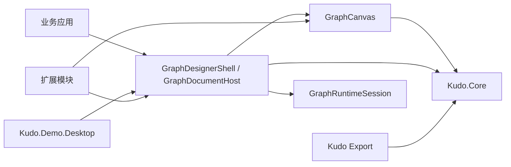
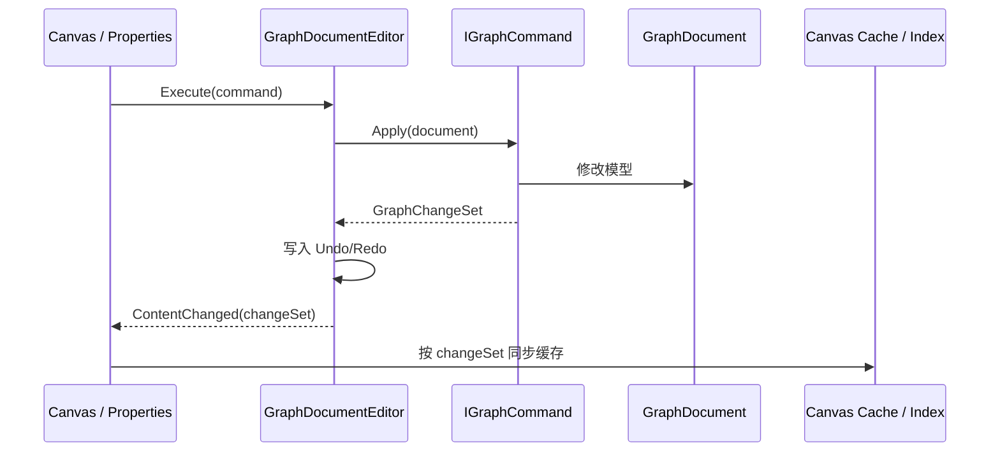
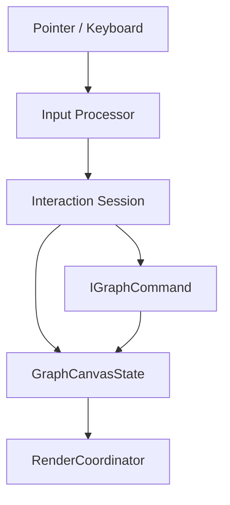
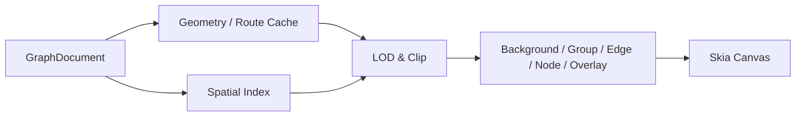
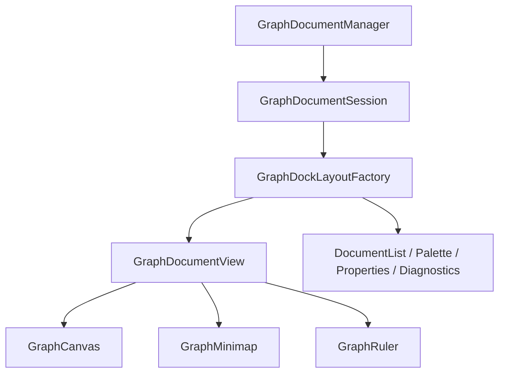
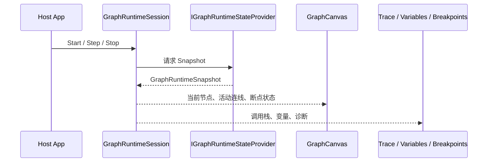

# Kudo.Avalonia 架构与设计

模型配置、属性 Schema、任务目录、`.mdl` 单文件和任务校验的统一格式见 [模型配置与任务文件格式设计](模型配置与任务文件格式设计.md)。本文只描述 SDK 的架构边界和运行时模型。

本文只保留 SDK 的稳定设计结论。实现流水、历史阶段计划和性能数据不放在这里，分别看 `../README.md`、`使用与开发手册.md`、`性能优化.md`。

## 1. 定位

Kudo.Avalonia 是面向 Avalonia 桌面应用的图编辑 SDK，负责节点、端口、连线、分组、画布交互、多文档工作区、属性面板、运行态可视化和导出打印。

设计边界：

| 层 | 做什么 | 不做什么 |
|---|---|---|
| `Kudo.Core` | 模型、命令、序列化、文档会话、运行态、校验、布局算法 | 引用 Avalonia、Dock、主题或业务 UI |
| `Kudo.Avalonia` | Canvas、Designer、Dock、属性编辑、Minimap、导出打印 | 固化业务节点和业务规则 |
| `Kudo.Avalonia.3D` | 可选 3D 预览控件 | 进入核心渲染链路 |
| `Kudo.Themes` | 统一主题资源层 | 保存业务视觉配置 |
| `Kudo.Demo.*` | 示例、验证和参考宿主 | 反向进入 SDK |

## 2. 总体结构

调用方优先接入 `GraphDesignerShell` 或 `GraphDocumentHost`。只需要纯画布时才直接使用 `GraphCanvas`。

## 3. 核心模型

| 模型 | 责任 |
|---|---|
| `GraphDocument` | 图文档根对象，包含节点、连线、分组、便签和画布设置 |
| `NodeModel` | 节点类型、标题、位置、尺寸、锁定状态、端口、外观和扩展属性 |
| `PortModel` | 方向、连接模式、数据类型、可见性和端口状态 |
| `EdgeModel` | 起点、终点、标签、路由、样式和运行态外观 |
| `GroupModel` | 成员节点、标题、折叠状态、内边距和扩展属性 |
| `GraphDocumentSession` | 当前文档的 Dirty、历史、任务目录、运行态和视图状态 |

模型规则：

- 坐标以图坐标保存，屏幕变换只存在于 `Viewport`。
- `Viewport` 的当前值属于文档状态，可以写入任务文件并在打开时恢复；`ViewportOptions` 是运行时 UI 策略，默认 10% 到 500%，不写入任务文件。
- Edge 保存端口引用和可选 Waypoint，不保存屏幕路径。
- `GraphCanvasSettings.ShowPorts` 控制画布级端口显示，`PortModel.IsVisible` 控制单端口显示；隐藏只影响渲染和交互，不使已有 Edge 端点失效。
- Group 不嵌套；节点最多属于一个 Group。
- 业务字段进入 `Properties` 扩展字典，不扩展 SDK 内置模型语义。

## 4. 文档与编辑流程

编辑原则：

- 宿主和 SDK 内置交互都应通过 `IGraphCommand` 修改模型。
- 热路径已经改过模型时，用 `RecordExecuted` 写入历史，避免重复执行。
- 直接修改公开模型是允许的，但必须调用 `Synchronize` 通知视图；缺少范围时回退全量刷新。
- Undo 后执行新命令会清空当前 Document 的 Redo 分支。

### Definition、State 与差量

- `GraphNodeDefinition` 是目录和创建模板，不进入任务文件；任务只保存 `NodeModel.Type` 及实例状态。
- 业务节点将版本化状态放在 `NodeModel.ExtensionState`。SDK 保持 Payload 不透明；`IGraphNodeStateProjectionResolver` 可由 State 重建节点尺寸和端口投影。
- 正式任务和当前草稿仍保存完整 `GraphDocument` XML。`GraphDocumentDeltaCalculator` 只提供可选的差量 API，不改变文件契约。
- 差量按稳定 ID 保存新增、删除和完整更新快照；`GraphDocumentDeltaApplier` 返回新文档，并用源 XML 快照哈希拒绝覆盖基线之后的编辑。
- 宿主采用差量保存时应定期压缩为完整快照，并将差量与其基线快照一同持久化；单独保存一条差量不能用于恢复任务。

## 5. 画布交互

| 行为 | 入口 | 结果 |
|---|---|---|
| 缩放 | 滚轮、按钮、`SetZoom`、`ZoomAt`、`ZoomBy` | 受 `ViewportOptions` 夹取，锚点图坐标不漂移 |
| 平移 | 中键、右键拖动、空格临时平移、`PanBy` | 只改 `Viewport.Offset` |
| 选择 | 单击、Shift、框选、API | 生成节点、分组、多 Edge、便签选择快照；多 Edge 保留一个主 Edge |
| 拖动 | 节点、Group、Waypoint、Edge 端点 | 预览实时更新，释放后写入一条历史 |
| 节点锁定 | `SetSelectedNodesLocked`、属性面板、Demo 右键菜单 | 保留选择、属性编辑和端口连接，阻止布局几何变化与删除 |
| 节点分层 | `GraphEditorContext.Edit.BringSelectedNodesToFront`、`SendSelectedNodesToBack` | 通过 `SetNodeOrderCommand` 写入完整顺序，保留多选相对顺序并支持 Undo/Redo |
| 临时手动连线 | 端口拖拽未落到目标端口时生成草稿 | 文档发生结构变更、画布卸载或取消操作时自动清理，不把孤立草稿写入任务 |
| 取消 | Esc | 恢复交互开始状态，不写历史 |
| 适应 | `FitToDocument`、`FitToSelection` | 计算目标范围并更新完整 Viewport |

同一时间只允许一个 `IGraphInteractionSession` 活动，避免拖动、框选、端点重连和文本编辑互相抢状态。

节点锁定是布局保护而不是只读。混合选择的移动、微调和删除会跳过锁定节点；锁定节点只绘制选中轮廓，不显示缩放和旋转手柄。批量锁定或解锁由一个 `CompositeGraphCommand` 表示，因此只占一条 Undo 历史。

节点分层只针对当前选中的节点。置顶将选中节点按文档顺序追加到 `GraphDocument.Nodes` 末尾，置底则插入开头；未选中节点的相对顺序不变。排序请求使用 `GraphEditOperation.ReorderNodes` 参与只读、锁定和宿主编辑策略校验，节点控制宿主同步时会重新应用 `ZIndex`。

右键菜单由宿主根据业务语言和剪贴板能力组合，SDK 通过 `GraphEditOperations`、`GraphEditRequest` 和 `GraphEditOperation` 提供统一编辑契约。宿主不应直接改写 `GraphDocument.Nodes`，菜单命令应调用上述 API 或提交 `IGraphCommand`。

## 6. 渲染与路由

关键约束：

- Edge 路径以图坐标缓存，平移和缩放不触发重路由。
- 智能正交路由额外跟踪障碍修订号；节点移动、尺寸变化和显式刷新会失效缓存。
- 空间索引用于命中、视口裁剪和选择视口内节点。
- Node Control 不随视口裁剪移除，只切换可见性，避免丢失输入状态或 OpenGL Context。

## 7. 多文档工作区

每个 Document 独立维护：

- `Viewport`、Dirty、保存路径和草稿路径。
- Undo/Redo 历史。
- Runtime Session、断点、快照、调用栈、变量和诊断。

任务目录以 `Manifest.xml` 和 `Task.xml` 为入口，资源统一放在 `Assets/`，资源路径只保存任务相对路径，不接受绝对路径或越界路径。`.mdl` 文件是该目录结构的 ZIP 压缩包。

## 8. Runtime 调试

Runtime 不修改文档模型。运行态颜色、动画、断点和诊断通过独立状态投影到 Canvas 与工具面板。

## 9. 扩展点

| 场景 | 扩展点 |
|---|---|
| 模型库 | `IGraphNodeCatalog`、`GraphNodeDefinition`、JSON Catalog |
| 节点创建 | `IGraphNodeFactory` |
| 自定义节点内容 | `GraphCanvas.NodeControls` |
| 属性页 | `IGraphPropertyEditorProvider` |
| 校验 | `IGraphValidationRule` |
| 渲染 | `IGraph*Renderer` |
| 端点锚点 | `IGraphPortPositionProvider`、`GraphCanvas.PortPositionProvider` |
| 路由 | `EdgeRoutingService`、`EdgeObstacleProvider`、`IGraphEdgeRouter` |
| 路径生成 | `IGraphEdgePathGenerator`、`GraphEdgeRoutingService.WithPathGenerator` |
| 导出 | `GraphExportOptions`、自定义 Renderer、嵌入内容策略 |

扩展只贡献能力，不直接持有长期 Canvas、Document 或 PropertiesView 引用；需要状态时由宿主注入或订阅窄事件。

## 10. 设计约束

- SDK 不保存业务流程语义，只保存通用图模型。
- 公开 API 优先稳定，内部协作对象保持 `internal`。
- 临时交互状态、渲染缓存和运行态状态不写入任务文件；文档 Viewport 的持久化遵循《模型配置与任务文件格式设计》。
- 所有可撤销模型修改必须能落到命令历史。
- 主题资源不应改变模型语义。
- Demo 是验收宿主，不是 SDK 内部依赖。
